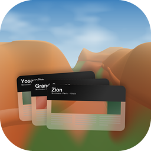
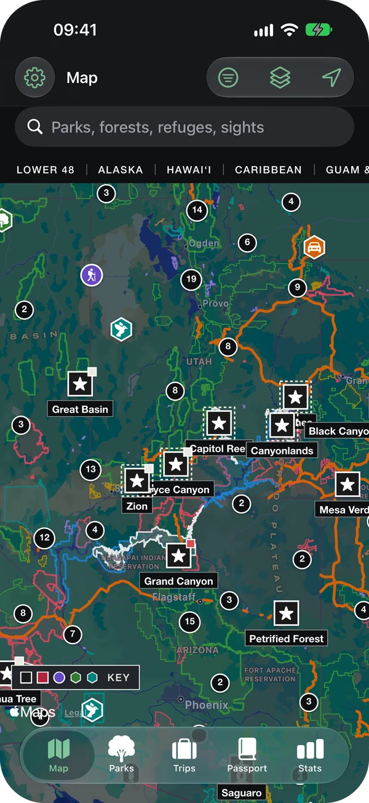
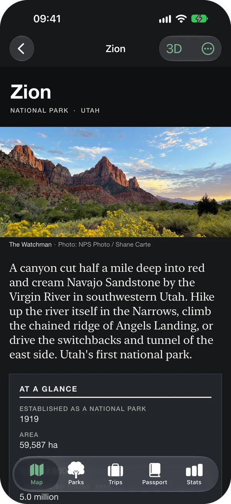
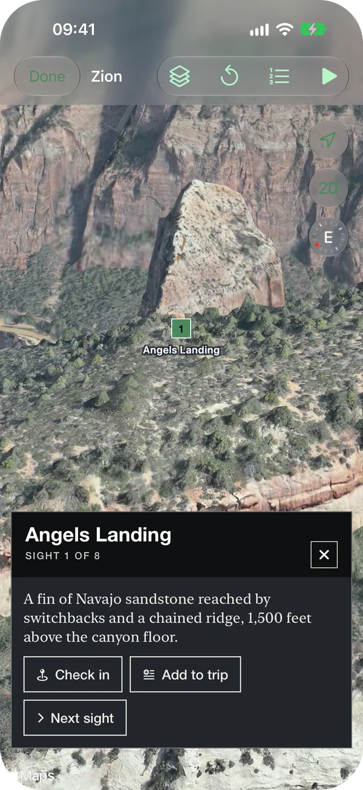
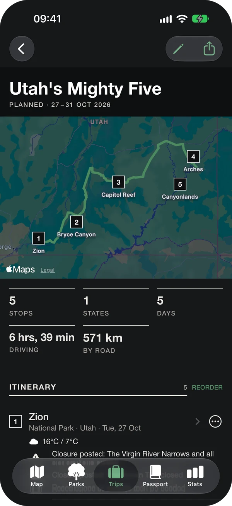
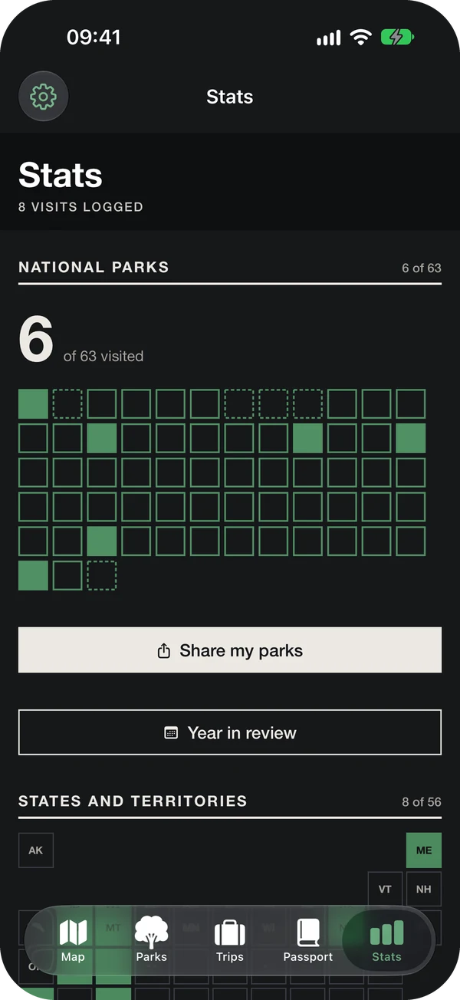

<p align="center">
  
</p>

<h1 align="center">Unigrids</h1>

<p align="center">
  Plan, explore and log visits to US public lands, all on one map.<br>
  A free, private, native app for iPhone, iPad and Mac.
</p>

<p align="center">
  <a href="https://github.com/leeyenkai/Unigrids/actions/workflows/ci.yml"></a>
  
  
  <a href="LICENSE"></a>
</p>

<p align="center">
  
  
  
  
  
</p>

## Features

- **US public lands on one map.** 5,515 places: every NPS unit, national forest and
  grassland, wildlife refuge, BLM monument and conservation area, National Natural
  Landmark, scenic byway and state park, each marked by type, with Interstate, US highway
  and Amtrak layers.
- **A guide for every national park**, laid out like the NPS Unigrid brochures, with the
  official brochure, a 3D view and, for 61 parks, a measured trail catalogue.
- **Trips** of parks, sights, trails and lodging, with drive times, forecasts, live
  closures and alert notifications for parks you are about to visit.
- **A visit log** you fill by hand, on arrival or from Photos. It stamps a digital
  passport, turns into stats and share cards, and exports in full.
- **Offline park maps** for Zion, Acadia, Yellowstone and Great Smoky Mountains.
- **Private by design.** No accounts, no analytics and no server of its own. Your log
  stays on your device, and syncs only through your own iCloud.

## Status

Version **0.9.0**, the production pass: everything planned for 1.0 except widgets, the
Watch app and offline maps for the other 59 parks. iCloud sync and WeatherKit wait on code
signing, so this build keeps the log on the device. It is not on the App Store yet; build
it from source. What has and has not been checked is in
[`docs/mvp-scope.md`](docs/mvp-scope.md); what changed is in [`CHANGELOG.md`](CHANGELOG.md).

## Building

You need macOS 27 and Xcode 27 (Swift 6.4, iOS 27 and macOS 27 SDKs).

```bash
git clone https://github.com/leeyenkai/Unigrids.git
cd Unigrids
scripts/bootstrap.sh     # check the toolchain, resolve packages
scripts/test.sh          # run the test suite
scripts/build.sh         # build for the iOS Simulator and macOS
```

Or open `App/Unigrids.xcodeproj` and run the `Unigrids` scheme.

Live park alerts are optional: put a free [NPS API key](https://www.nps.gov/subjects/developer/get-started.htm)
in `.env` as `NPS_API_KEY=…` and run `scripts/write-secrets.sh` before building. Without
it the app runs normally and the alerts panel stays hidden.

## How it is built

Almost all of the code lives in a local Swift package, `UnigridsKit`; the Xcode project is
a thin app target around it ([ADR 0003](docs/adr/0003-spm-first-thin-app-target.md)).

```
App/                    Thin app target: entry point, assets, entitlements
Packages/UnigridsKit/   The Swift package
  UnigridsCore            Domain model and rules (Foundation only)
  UnigridsReference       Bundled, read-only reference data
  UnigridsLog             The visit log, in SwiftData
  UnigridsDesign          The Unigrid design system
  UnigridsFeatures        SwiftUI screens
Pipeline/               Python pipeline that builds the bundled reference data
Tools/IconGenerator/    Draws the app icons
docs/                   Scope notes and architecture decision records
```

Reference data ships inside the app and is rebuilt by the pipeline from public
government sources for each release. [`SPECIFICATION.md`](SPECIFICATION.md) describes
what the app should do and [`docs/adr/`](docs/adr/) why it is built the way it is.

## Contributing

Issues and pull requests are welcome. Start with [`CONTRIBUTING.md`](CONTRIBUTING.md) and
the working agreement in [`AGENTS.md`](AGENTS.md).

## Licence

The code is [MIT licensed](LICENSE). Bundled NPS material and third-party open data keep
their own terms, listed with every data source in [`NOTICE.md`](NOTICE.md).

Unigrids is an independent project and is **not affiliated with or endorsed by the
National Park Service**. It uses public-domain NPS material and never the NPS arrowhead.
